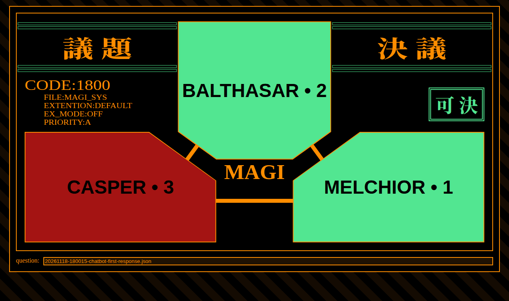

# MAGI-UI

A local viewer that shows results of the [MAGI skill](https://github.com/jwsung91/MAGI) on the screen of [TomaszRewak/MAGI](https://github.com/TomaszRewak/MAGI).

> **Unofficial.** Not affiliated with *Neon Genesis Evangelion* or its rights holders. The screen comes from TomaszRewak/MAGI, a fan recreation, and is downloaded at install time; this repository contains none of its code or graphics, only the two screenshots below. **Local use only:** the server binds to `127.0.0.1`; do not expose it to a network. If a rights holder asks, this repository will be taken down.

| 2/3 pass, normal proposal | Critical proposal rejected at 2/3 |
|---|---|
|  |  |

Left: a real result of the skill (1.6.0, the Korean chatbot fixture), `PRIORITY:A`. Right: `samples/09_rejected_critical_2of3.json`, `PRIORITY:AAA`; a critical proposal needs all three approvals.

## How it works

TomaszRewak/MAGI is a Dash app whose `ai.py` asks OpenAI. MAGI-UI keeps the original screen and swaps the data source:

| File | What it does |
|---|---|
| `ai.py` | Drop-in replacement with the same function names. Reads a MAGI result JSON instead of calling OpenAI. |
| `main.py.patch` | Small callback patch: reload on every Enter, use the skill's resolution for the result panel, show the proposal text in the modal, bind to `127.0.0.1` with debug off, and drop upstream's **access code** field (its OpenAI key box, unused here). |
| `assets/magi-ui.css`, `assets/fonts/` | The kanji labels in a serif face, stretched 1.3× instead of upstream's 2×. The font holds only those characters, cut from Noto Serif JP (SIL Open Font License), so it looks the same on every machine and needs no network. |
| `components/magi_status.js` | The status lines at the top left, filled from the result (see below). Replaces upstream's `status.js` in the layout; that file itself is not changed. |
| `components/magi_response.js` | The result panel with labels that match the skill's resolution (see below). Replaces upstream's `response.js` in the layout; same colors and behaviour. |
| `setup.sh` | Fetches upstream at a pinned commit, applies the changes above, creates a virtualenv, copies samples. |
| `requirements.lock` | Tested dependency versions (Python 3.13, dash 2.18.2). |
| `samples/` | Result files for every outcome. |
| `result.schema.json` | Copy of the result format (version 2). The source of truth is in the [MAGI repo](https://github.com/jwsung91/MAGI/blob/main/skills/magi/result.schema.json). |

The upstream graphics (`components/*.js`, `assets/style.css`) are not modified; `assets/magi-ui.css` only overrides the font and stretch of the kanji labels, `magi_status.js` and `magi_response.js` keep upstream's class names and colors, the headers read 議題 / 決議 (agenda / resolution) instead of 質問 / 解決, and the layout differs only by the missing access code field.

## Install and run

Requires `git`, Python 3 (tested on 3.13), and a shell.

```bash
git clone https://github.com/jwsung91/MAGI-UI.git
cd MAGI-UI
bash setup.sh            # installs into ./MAGI (or pass a path)
cd MAGI
MAGI_RESULTS_DIR=results .venv/bin/python main.py
```

Open `http://127.0.0.1:8050`, type a file name (e.g. `02_passed_2of3.json`) or `latest` in the **question** field, and press Enter. Pressing Enter again reloads the file. Click a unit panel to see that unit's opinion.

| Variable | Default | Meaning |
|---|---|---|
| `MAGI_RESULTS_DIR` | `results` | Folder the viewer reads |
| `MAGI_UI_LANG` | `en` | Modal labels: `en` or `ko` |
| `MAGI_PORT` | `8050` | Port |

## Connect the skill

In Claude Code, the MAGI skill writes each result as JSON when `MAGI_RESULTS_DIR` is set. Point it at the viewer's folder:

```bash
export MAGI_RESULTS_DIR=/path/to/MAGI-UI/MAGI/results
claude
# /magi <your proposal>   → the result file path is printed at the end
```

Then type `latest` in the viewer and press Enter.

## Mapping

The result panel reads 可決 (passed), 否決 (rejected), 情報 (information), 異常 (error) instead of upstream's 合意, 拒絶, 情報, 誤差: a 2/3 pass is not an agreement, and a failed unit is not a margin of error.

| Skill resolution | Result panel |
|---|---|
| passed | passed (a 2/3 pass leaves the rejecting unit red; the modal notes it) |
| rejected | rejected (a critical proposal rejected with 1 or 2 approvals leaves the approving units green; the modal notes that all three were needed, see `09_rejected_critical_2of3.json`) |
| on hold | info (no matching label; the modal says it is on hold). Only results of skill versions before 1.6.0; from 1.6.0 a critical split is rejected |
| error | error (unit error, malformed JSON, or invalid values) |
| information mode | info |

| Status line | Shows |
|---|---|
| `CODE` | the time in the result file name (`YYYYMMDD-HHMMSS-…` gives `HHMM`), else the file's modified time |
| `FILE` | `MAGI_SYS`, fixed |
| `EXTENTION` | the preset: `DEFAULT`, `ETHICS`, `CODE_REVIEW`, `PERSONAL`, `ORIGINAL`, `CUSTOM` |
| `EX_MODE` | `OFF`, fixed |
| `PRIORITY` | the grade: `AAA` critical, `A` normal, `----` information mode |

Before the first query the lines show upstream's values (`CODE:473`, `EXTENTION:????`, `PRIORITY:AAA`).

| Unit verdict | Unit panel |
|---|---|
| approve | green |
| reject | red |
| error | black |

The panels show the main proposal. If the result records how each unit voted on follow-up proposals (`follow_ups[].units`), a unit's modal also lists each follow-up with its resolution and that unit's verdict, confidence, and rationale (see `08_follow_ups.json`). Older results without `follow_ups[].units` still load; their follow-ups are simply not shown. The rest of the resolution (grade, minority opinion, and the debate round of results before 1.6.0) is in the skill's Markdown output.

## Tested

- Fresh `setup.sh` install at the pinned commit.
- Every sample through the Dash callbacks, plus modal open/close in headless Chrome.
- Follow-up votes: `08_follow_ups.json` through the callbacks, and rejection of malformed `follow_ups[].units` (missing unit, unknown verdict, more than two follow-ups).
- Labels in `en` and `ko`.

## Notes

- Upstream is pinned to `98a4d0184b1b0013e2216689c770127b6aff2efc` (2023-10-11).
- dash 2.9.3 and earlier are affected by CVE-2024-21485; this lock uses 2.18.2. dash 2.x needs `setuptools<81` (`pkg_resources`).
- Units are identified by upstream's personality strings (scientist / mother / woman).

## License

MIT for the code in this repository ([LICENSE](LICENSE)). Upstream's license and notes are in [THIRD_PARTY_NOTICES.md](THIRD_PARTY_NOTICES.md).
