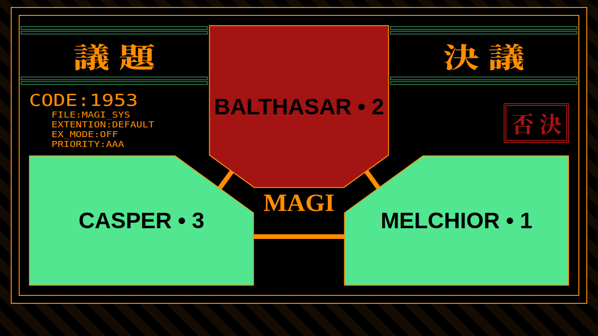
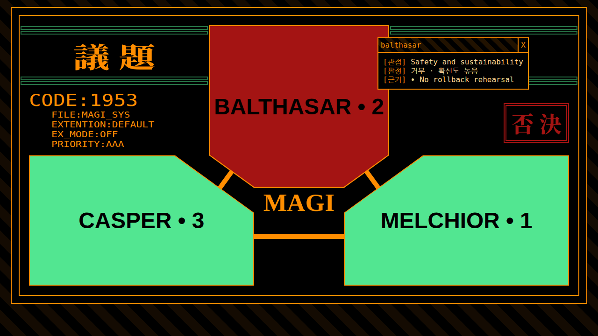

# MAGI-UI

A viewer for results of the [MAGI skill](https://github.com/jwsung91/MAGI): one HTML file, opened in a browser. No server, no install, no network.

> **Unofficial fan work.** Not affiliated with *Neon Genesis Evangelion* or its rights holders. Third-party licenses are in [THIRD_PARTY_NOTICES.md](THIRD_PARTY_NOTICES.md). If a rights holder asks, it will be taken down.

| Critical proposal rejected at 2/3 | A unit's opinion (Korean result) |
|---|---|
|  |  |

Left: `samples/09_rejected_critical_2of3.json`. Right: the same result with BALTHASAR-2 clicked, Korean labels.

## Use

1. Open `magi-ui.html` in a browser (Chrome, Edge, Firefox, Safari).
2. Drop result files or the results folder on the page, or click **MAGI** in the middle to choose the folder. The newest result opens; the left and right arrow keys move between the results loaded.
3. Click to read:

| Click | Window |
|---|---|
| 議題 | The agenda (the question), the follow-up proposals, the file |
| 決議, or the result box | The resolution, approvals and grade, a note where the label alone could mislead, the follow-ups' resolutions, the minority opinion |
| A unit panel | That unit's verdict, confidence, rationale, what would flip it, doubted premise, recommendations, and its votes on follow-ups |

Esc or X closes the window. There are no other controls on the screen.

Labels follow the browser language (English or Korean); add `?lang=ko` or `?lang=en` to the address to choose. Files are read in the browser with the File API and go nowhere. To see a result written after you loaded the folder, load it again.

## Connect the skill

The MAGI skill writes each result as JSON when `MAGI_RESULTS_DIR` is set (Claude Code, Codex, Gemini CLI, and other hosts that run shell commands):

```bash
export MAGI_RESULTS_DIR=~/magi-results
claude
# /magi <your proposal>   → the result file path is printed at the end
```

Then drop `~/magi-results` on the viewer, or click MAGI and choose it.

## What the screen shows

| Part | Shows |
|---|---|
| Headers | 議題 / 決議 (agenda / resolution) |
| Result box | The resolution: 可決 / 否決 / 情報 / 異常 (below) |
| Unit panels | Each unit's verdict: green approve, red reject, black error; blue in information mode |
| Status lines | Filled from the result (below) |
| Windows on click | See Use above |

| Resolution | Label | Note |
|---|---|---|
| passed | 可決 | For a 2/3 pass: a normal proposal needs two of the three aspects |
| rejected | 否決 | For a critical proposal with 1 or 2 approvals: it needs all three (skill 1.6.0 on) |
| on hold | 情報 | Results of skill versions before 1.6.0 only |
| error | 異常 | A unit failed, so there was no vote of two |
| information mode | 情報 | |

可決 / 否決 (passed / rejected) rather than "agreement / refusal": from skill 1.6.0 a resolution counts three aspects, and a 2/3 pass is not an agreement.

| Status line | Shows |
|---|---|
| `CODE` | The time in the result file name (`YYYYMMDD-HHMMSS-…` gives `HHMM`), else the file's modified time |
| `FILE` | `MAGI_SYS`, fixed |
| `EXTENTION` | The preset: `DEFAULT`, `ETHICS`, `CODE_REVIEW`, `PERSONAL`, `ORIGINAL`, `CUSTOM` |
| `EX_MODE` | `OFF`, fixed |
| `PRIORITY` | The grade: `AAA` critical, `A` normal, `----` information mode |

A file that is not valid JSON, or that breaks the core rules of the result format (version 2, the three units, the verdict values), is shown as 異常 with the reason.

## Files

| File | What it is |
|---|---|
| `magi-ui.html` | The viewer. HTML, CSS and JavaScript in one file, with the kanji font embedded |
| `samples/` | Result files for every outcome, including `99_invalid.json` to show the error display |
| `result.schema.json` | Copy of the result format (version 2). The source of truth is in the [MAGI repo](https://github.com/jwsung91/MAGI/blob/main/skills/magi/result.schema.json) |
| `fonts/` | The kanji font embedded in the viewer: 議題決可否情報状態異常 cut from Noto Serif JP, and its license |
| `docs/` | The screenshots above |

The kanji labels are drawn with that font so they look the same on every machine. To change a label, cut the font again to the new characters (for example with `pyftsubset` from fontTools) and replace the base64 string in `magi-ui.html`.

## License

MIT for the code in this repository ([LICENSE](LICENSE)). Embedded third-party parts keep their own licenses; see [THIRD_PARTY_NOTICES.md](THIRD_PARTY_NOTICES.md).
